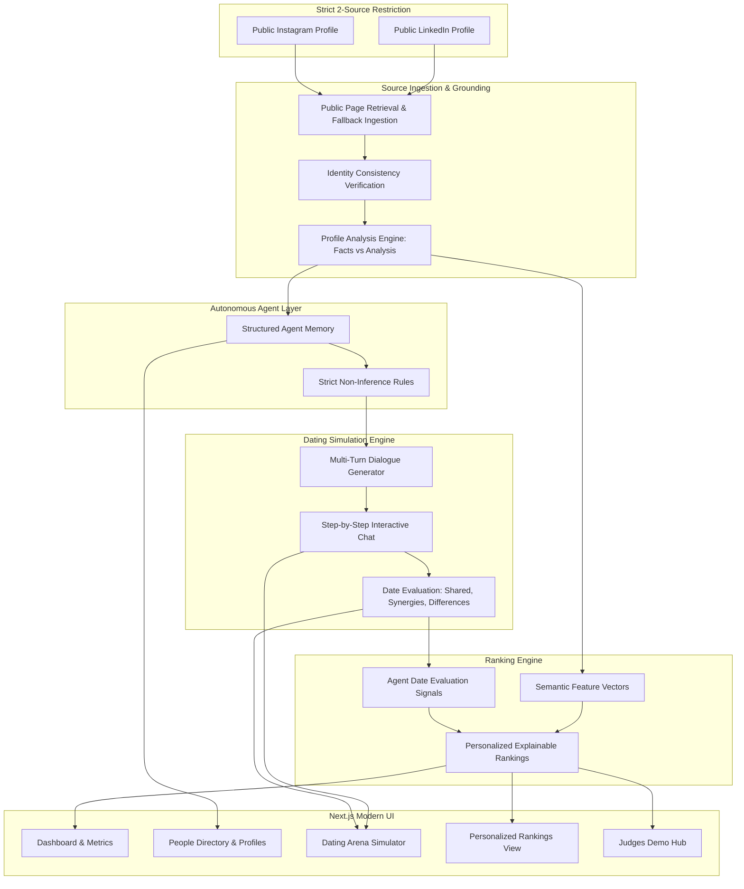

# Agentic Dating: Autonomous AI Agents Dating from Public Social Profiles

Agentic Dating is a full-stack web application where every person is represented by an autonomous AI agent. The agent analyzes **exactly two public sources** — their public LinkedIn profile and public Instagram profile — builds a structured persona, simulates dates with other people's agents in the Dating Arena, and generates explainable, personalized compatibility rankings.

---

## 🏛 Architecture Overview



---

## 🔒 Source Restrictions & Safety Rules

1. **Exactly Two Public Sources**: Only public LinkedIn and public Instagram URLs are accepted. No third-party biography scrapers, Google search dumps, or secondary social networks.
2. **Zero Inferred Sensitive Characteristics**: The system **strictly forbids** inferring religion, health, sexuality, political affiliation, or ethnicity.
3. **No Fabricated Facts**: Every extracted skill, hobby, project, and topic is grounded in source evidence and tagged with confidence levels (`high`, `medium`, `low`) and source attribution (`LinkedIn`, `Instagram`, or `Both`).
4. **Distinction of Facts vs. Analysis**: Extracted facts from sources are explicitly separated from AI-generated compatibility assessments.

---

## 🛠 Tech Stack

- **Frontend**: Next.js 16 (App Router), TypeScript, Tailwind CSS, Lucide React, Framer Motion
- **Backend**: FastAPI (Python 3.11+), SQLAlchemy, Pydantic v2, HTTPX, BeautifulSoup4
- **Database**: SQLite (local development) / PostgreSQL with pgvector (Supabase production ready)
- **AI Engine**: OpenAI API (`gpt-4o-mini`) with high-fidelity deterministic heuristic fallback (runs completely self-contained offline without API key dependencies)
- **Retrieval & Scoring**: Deterministic normalized semantic feature vectors + multi-signal date conversation evaluation

---

## 🚀 Quick Start (Local Development)

### 1. Prerequisites
- Python 3.11+
- Node.js 18+ and npm

### 2. Backend Setup
```bash
# Clone the repository
cd Test-1

# Create and activate virtual environment
python -m venv backend_venv
# On Windows:
.\backend_venv\Scripts\activate
# On Linux/macOS:
# source backend_venv/bin/activate

# Install backend dependencies
pip install fastapi uvicorn pydantic sqlalchemy httpx beautifulsoup4 python-dotenv numpy openai

# Seed the database with 25 realistic tech profiles, precomputed dates, and rankings
python seed.py

# Start FastAPI backend server (port 8000)
python -m uvicorn backend.main:app --host 127.0.0.1 --port 8000 --reload
```

### 3. Frontend Setup
```bash
# In a new terminal window:
cd frontend

# Install npm dependencies
npm install

# Start Next.js development server (port 3000)
npm run dev -- -p 3000
```

Open [http://localhost:3000](http://localhost:3000) in your browser.

---

## ⚡ 3-Minute Hackathon Demo Sequence for Judges

1. **Dashboard (`/`)**:
   - Dynamic real-time statistics: 25 People, 25 Agents, 8 Completed Dates, 600 Pairwise Rankings.
   - Review the 6-step How It Works pipeline and the featured date.
2. **People Directory (`/people`)**:
   - Filter through 25 realistic tech professionals (AI researchers, engineers, founders, designers).
   - Click **View Profile** on Elena Rostova or Marcus Vance.
3. **Profile Deep Dive (`/people/[id]`)**:
   - Inspect verified skills, hobbies, public projects, and conversation topics.
   - Review the **Source Evidence Cards** citing exact LinkedIn and Instagram excerpts with confidence ratings.
4. **Dating Arena (`/dating`)**:
   - Select two agents (e.g., Elena Rostova and Marcus Vance) and click **Start Date**.
   - Watch the multi-turn simulated autonomous conversation unfold with dynamic typing indicators, phase labels, and evidence citations.
   - Alternatively click **Step** or **Skip** to instantly generate the **Post-Date Compatibility Breakdown** (Score, Shared Interests, Synergies, Differences, Quotes).
5. **Personalized Rankings (`/rankings`)**:
   - Select any person to inspect their personalized ranking list.
   - Review explainable match reasons, shared skills, complementary traits, and verifiable conversation dialogue quotes.
6. **Demo Showcase Hub (`/demo`)**:
   - Inspect the entire 25-person matrix and 1-click database reset button for quick demonstration replay.

---

## 📡 REST API Documentation

| Method | Endpoint | Description |
|---|---|---|
| `GET` | `/api/stats` | Dashboard metrics: total people, agents, dates, rankings, system status |
| `GET` | `/api/people` | List people with search and filter tabs |
| `POST` | `/api/people` | Create person from LinkedIn & Instagram URLs with public extraction & identity verification |
| `GET` | `/api/people/{id}` | Get person details and agent metadata |
| `GET` | `/api/people/{id}/profile` | Get structured profile analysis and source evidence cards |
| `POST` | `/api/people/{id}/analyze` | Re-run extraction and update persona |
| `POST` | `/api/dates` | Start autonomous date session between two agents |
| `GET` | `/api/dates` | List all date sessions |
| `GET` | `/api/dates/{id}` | Get date session dialogue transcript and breakdown |
| `POST` | `/api/dates/{id}/continue` | Generate next conversation turn dynamically |
| `POST` | `/api/dates/{id}/complete` | Force completion and calculate compatibility score |
| `GET` | `/api/rankings/{person_id}` | Get explainable personalized rankings for specific person |
| `POST` | `/api/rankings/generate` | Trigger rankings recalculation |
| `POST` | `/api/demo/seed` | Reset and seed 25 precomputed demo profiles, dates, and rankings |

---

## 🌐 Production Deployment Guide

### Frontend Deployment (Vercel)
1. Push this repository to GitHub.
2. Import project into [Vercel](https://vercel.com).
3. Set **Root Directory** to `frontend`.
4. Configure Environment Variable:
   - `NEXT_PUBLIC_API_URL`: URL of your deployed backend (e.g., `https://agentic-dating-backend.onrender.com`).
5. Deploy.

### Backend Deployment (Render / Railway)
1. Create a new Web Service on [Render](https://render.com) or [Railway](https://railway.app).
2. Set Build Command:
   ```bash
   pip install -r backend_requirements.txt
   ```
3. Set Start Command:
   ```bash
   uvicorn backend.main:app --host 0.0.0.0 --port $PORT
   ```
4. Set Environment Variables:
   - `OPENAI_API_KEY`: Your OpenAI API Key (optional)
   - `FRONTEND_URL`: URL of your deployed Vercel frontend

### Database Deployment (Supabase PostgreSQL)
1. Create a Supabase project at [supabase.com](https://supabase.com).
2. Run `backend/schema.sql` in the Supabase SQL Editor.
3. Configure `DATABASE_URL` in backend environment pointing to your Supabase PostgreSQL connection string.

---

## 🏆 Hackathon MVP Checklist Verification

- [x] Full stack functional backend and frontend
- [x] Exactly two public sources enforced (LinkedIn + Instagram)
- [x] Privacy rules: zero sensitive attribute inference
- [x] Identity consistency check with user verification notices
- [x] Source attribution & confidence ratings on all profile attributes
- [x] Interactive Dating Arena with live multi-turn agent conversations
- [x] Real-time typing indicators, phase labels, pause/step/skip controls
- [x] Post-date analysis: shared interests, complementary synergies, differences, evidence quotes
- [x] Multi-signal explainable ranking engine
- [x] Pre-seeded 25 tech professionals dataset for immediate judging
- [x] 1-Click Demo Hub & Seed Reset
- [x] Verified zero TypeScript errors and clean production build
